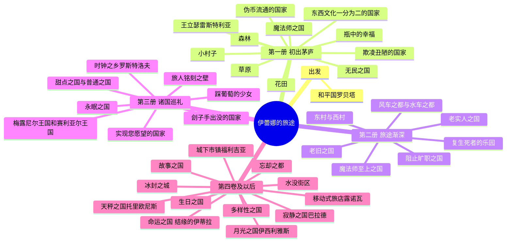

# 伊蕾娜旅途路线图

伊蕾娜的旅途没有终点。

她骑着扫帚，从和平国罗贝塔出发，穿过一个又一个国家，遇见形形色色的人，旁观形形色色的故事。她没有非要抵达哪里，只是走，只是写。

这篇文章按动画顺序，结合小说章节，把她走过的国家与地点整理成一份尽可能完整的路线图。

## 出发：和平国罗贝塔

伊蕾娜的家乡，也是她旅途的起点与归处。

她在这里长大，读着《妮可冒险记》，梦想成为像妮可一样周游列国的魔女。后来她在附近的森林里接受星尘魔女芙兰的教导，成为魔女见习生，最终获得了「灰之魔女」的称号。一切从这里开始。

## 旅途路线图

## 第一册：初出茅庐

动画前几集主要改编自小说第一册，伊蕾娜在这里正式踏上旅途。

### 魔法师之国

伊蕾娜旅途的第一站，一个只允许魔法师入境的国家。

她本想像《妮可冒险记》里那样以魔女身份受到优待，却在丢失星辰勋章后遇到了当时还是魔法师的沙耶。两人为了各自的勋章展开了一场追逐，也由此结下了不解之缘。

这是灰之魔女故事真正的开端。

### 花田

伊蕾娜在旅途中路过的一片花田，遇到了花丛中的女孩。

这片花田里生长着一种美丽却非常危险的花。伊蕾娜在这里目睹了美丽背后的残酷——有些东西看起来温柔，靠近了才知道危险。

### 森林

伊蕾娜在森林里遇到了一个正在寻找妹妹的肌肉男。

一段轻松的小插曲，旅途里少有的滑稽故事。

### 伪币流通的国家

一个流通伪币的国家。

伊蕾娜在这里被卷入了一系列事件，最终揭开了伪币背后的秘密。

### 草原

伊蕾娜在草原上遇到了两个无法决定胜负的男人。

一件旅途中的小事，关于胜负与执念。

### 瓶中的幸福

在一个小村庄里，伊蕾娜遇到了一个用瓶子收集幸福的男孩。

幸福可以被装进瓶子吗？这个故事给了一个温柔的答案，也留了一点遗憾。这是《魔女之旅》早期最令人心碎的故事之一。

### 东西文化一分为二的国家

一个风俗习惯两极分化的国家。

伊蕾娜在这里见证了文化碰撞下的荒唐与无奈。

### 欺凌丑陋的国家

一个丑美颠倒的国家，会歧视他们认为是丑的人。

伊蕾娜在这里遇到了一个因为公主的一己之愿而被颠倒价值观的国度。什么是美，什么是丑，这个国家给出了一个扭曲的答案。

### 无民之国

一片废墟中的国家。

伊蕾娜在唯一没被毁灭的王室城堡里遇到了米拉罗丝——一个失去记忆的魔女，也是这个国家的王女。她和毁灭自己国家的巨兽陷入了一场战斗。

独自留守早已灭亡的国家，这是《魔女之旅》最安静也最孤独的一站。

### 王立瑟雷斯特利亚

芙兰老师的故乡。

伊蕾娜在这里短暂重逢了老师，也在这座城市里被卷进了一场追逐。半年前她拿着书来过这里，半年后再来，故事变了。

### 小村子

伊蕾娜在这里遇到一位得了不治之症的青年，以及关于百灵药的故事。

## 第二册：旅途渐深

### 魔法师至上之国

一个魔法师地位至上的国家，麻瓜和亚尼玛受到歧视。

故事围绕列车这种出行工具展开，探讨了阶级与偏见。什么是价值？一个很耐人寻味的问题。

### 东村与西村

两个相邻却对立的村庄。

### 风车之都与水车之都

两座风格迥异的城市。

### 老实人之国

一个与「诚实之国」不同的老实人国家。伊蕾娜在这里再次遇到了沙耶，两人之间的关系有了新的变化。

### 阻止旷职之国

一个关于怠惰与勤勉的国家。

### 复生死者的乐园

一个可以让死者复活的乐园。

伊蕾娜在这里目睹了生与死的边界。有些东西回来了，但不再是原来的样子。

### 老旧之国与复活的猫神大人

一个老旧的国家，以及一只复活的猫神。

伊蕾娜在这里见证了一场关于再生与信仰的故事。

## 第三册：诸国巡礼

### 永眠之国

一个与安详永眠相关的国家。

### 踩葡萄的少女

一个以葡萄酒闻名的村子。

伊蕾娜本来不想卷进去，但斗志被一点点带着走，最后亲自踩了一天葡萄。轻松的一站，也是旅途里少有的轻快故事。

### 甜点之国与普通之国

两个相邻却截然不同的国家。

一边是甜点的国度，一边是普通的国度。伊蕾娜在这里遇到了一个菜鸟旅人。

### 梅露尼尔王国和赛利亚尔王国

两个王国之间的故事。

### 时钟之乡罗斯特洛夫

薰衣魔女埃斯特尔的故事。

这是《魔女之旅》最沉重的一集。伊蕾娜陪埃斯特尔回到过去，试图改变好友瑟雷娜的命运，却发现瑟雷娜本身就是凶手。埃斯特尔最终以自己和瑟雷娜之间的记忆为代价，再度处决了好友。回到现在后，面对失去与昔日好友记忆的埃斯特尔，伊蕾娜对自己的无能无力感到绝望并落泪。

有些悲伤逆流而上，拦不住。

### 旅人铭刻之壁

两个互相敌对的国家，被一堵墙隔开。

这是《妮可冒险记》里描述过的地方。伊蕾娜站在墙前，看到的不是敌意，而是人与人之间那些说不清的距离。

### 刽子手出没的国家

一个被刽子手阴影笼罩的国家。

### 实现您愿望的国家

伊蕾娜穿过写着「实现梦想之地」的大门，在熟悉的城堡里遇到了另一个戴着眼镜的自己。很多个伊蕾娜，很多种可能。她的愿望到底是什么？这个问题留给了观众。

## 第四卷及以后：小说中的诸国

动画只有 12 集，但伊蕾娜的旅途远不止这些。

### 忘却之都

一个与记忆和遗忘有关的城市。

伊蕾娜在这里遇到了艾姆妮西亚——一个失去记忆的魔女。故事围绕记忆的丧失与找回展开，是小说中篇幅较长的一条线。

### 水没街区

被水淹没的街区。

### 冰封之城

一座被冰覆盖的城市。伊蕾娜在这里遇到了勇者、飞龙与活人祭品的故事。

### 城下市镇福利吉亚

一座城下小镇，伊蕾娜在这里遇到了沉默的信鸽。

### 天秤之国托里欧尼斯

小说第八卷的舞台，一个以天秤为象征的国家。

### 月光之国伊西利雅斯

小说第十五卷的舞台，月光之国。这里有直率的魔女，兴趣是冒险与发明。

### 寂静之国巴拉德

伊蕾娜曾前往这里的「黑色，金色与灰色的面包店」吃面包。

### 移动式旅店露诺瓦

一个移动的旅店，伊蕾娜在这里听露诺瓦讲述过去的故事。

### 命运之国「结缘的伊蒂拉」

一个号称“命运之人必定相遇”的国家。伊蕾娜偶然进入这里，被告知不按照“恋爱管理局”的安排与命运之人相爱就无法离开。

### 生日之国

一个以生日为主题的国度。

### 故事之国

一个关于故事本身的国度。

### 多样性之国

一个尊重多样性的国家。

### 其他地点

小说中还出现了：伪币流通的国家、东西文化一分为二的国家、狼人或是某种别的东西之故事、苹果杀人事件、骷髅与魔女、吸血鬼的村庄、龙与魔女的约定、沙耶与席拉的过去等大量短篇故事发生地。

## 小说最新进展

小说已经出版到 24 卷以上。

第 24 卷中，伊蕾娜将经历帮魔法学校的大小姐做恋爱咨询、被美少年少爷与黑衣人追杀、在一分为二的国家被卷入居民间的纷争、和自称史莱姆的少女一同潜入「梦境世界」等事件。

第 25 卷中，她将遇到做出传说级美味面包的料理人、在梦想与现实间挣扎的服饰设计师、尊重自由的原旅人、被驱逐的「狼之魔女」、以及成为国一番魔法师的「羊之魔女」。

## 写在最后

这份路线图从罗贝塔出发，一路延伸到小说最新的章节。动画 12 集只是伊蕾娜旅途的冰山一角，小说已经出版到 25 卷，她还在走，还在写。

每个国家都是一面镜子，照出人性的某一面。这也是《魔女之旅》最迷人的地方——它不急着抵达终点，只是让你跟着一个灰发魔女，一段一段地看下去。

旅途还长，慢慢走。

—— 殇恋
