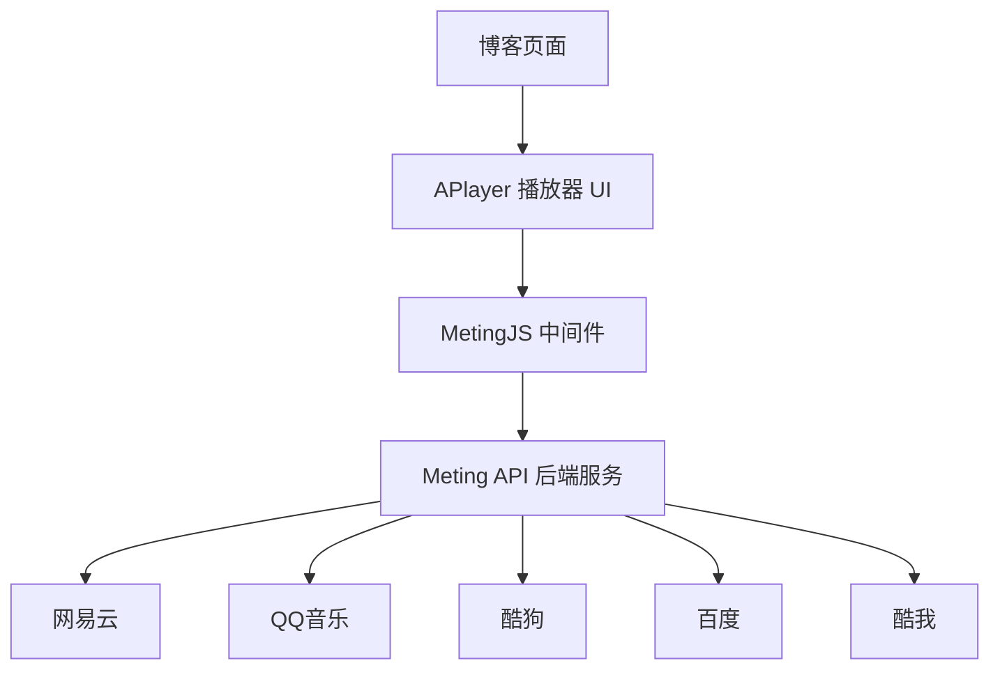

## 前言

为博客添加音乐播放器是常见需求。在对比多种方案后，**Meting API + APlayer** 这一组合成熟度高、社区活跃、文档完善，适合个人博客使用。

本文按照实际搭建流程，从架构说明、后端部署、前端接入到参数配置，完整记录整个过程，并附上完整示例、常见问题与解决方案。

## 〇、官方地址

| 项目 | 地址 |
| :--- | :--- |
| APlayer 官网 | [https://aplayer.js.org](https://aplayer.js.org) |
| APlayer GitHub | [https://github.com/DIYgod/APlayer](https://github.com/DIYgod/APlayer) |
| Meting 框架 GitHub | [https://github.com/metowolf/Meting](https://github.com/metowolf/Meting) |
| MetingJS GitHub | [https://github.com/metowolf/MetingJS](https://github.com/metowolf/MetingJS) |
| Meting API (Node.js) | [https://github.com/xizeyoupan/Meting-API](https://github.com/xizeyoupan/Meting-API) |
| Meting API (PHP) | [https://github.com/injahow/meting-api](https://github.com/injahow/meting-api) |

APlayer 是一个 HTML5 音乐播放器，MetingJS 是基于 APlayer 封装好的插件，开箱即用。

.avif)

## 一、架构说明

这套方案由三个部分组成：



各部分的职责：

| 组件 | 职责 |
| :--- | :--- |
| Meting API | 后端服务，负责从各音乐平台抓取数据 |
| MetingJS | 中间件，连接 APlayer 与 Meting API |
| APlayer | 前端播放器界面，负责展示与交互 |

实际需要部署的只有 **Meting API** 一个部分，其余两个在前端引入即可。

## 二、完整示例

以下为一个可直接运行的完整 HTML 文件。保存为 `.html` 后用浏览器打开，即可看到播放器效果。

```html title="完整可运行的示例"
<!DOCTYPE html>
<html lang="zh-CN">
<head>
  <meta charset="UTF-8">
  <meta name="viewport" content="width=device-width, initial-scale=1.0">
  <title>Meting API + APlayer 示例</title>

  <!-- APlayer 样式 -->
  <link rel="stylesheet" href="https://cdn.jsdelivr.net/npm/aplayer/dist/APlayer.min.css">

  <!-- APlayer 脚本 -->
  <script src="https://cdn.jsdelivr.net/npm/aplayer/dist/APlayer.min.js"></script>
  <!-- MetingJS 脚本 -->
  <script src="https://cdn.jsdelivr.net/npm/meting@2/dist/Meting.min.js"></script>
</head>
<body>

  <h1>我的音乐播放器</h1>

  <!-- 播放器标签 -->
  <meting-js
    server="netease"
    type="playlist"
    id="60198"
    fixed="false"
    autoplay="false"
    theme="#8A9BA8"
    api="https://你的meting-api域名/api?server=:server&type=:type&id=:id"
  ></meting-js>

</body>
</html>
```

> [!NOTE] 运行前需要修改
> 将 `api` 属性中的 `https://你的meting-api域名` 替换为实际部署的 Meting API 地址。若尚未部署，可先用第八节的公共实例测试。

## 三、效果预览

播放器有两种常用模式。

**吸底迷你模式**（`fixed="true"` + `mini="true"`）：固定在页面底部，默认收起为一个小条，仅显示播放/暂停按钮和歌名。点击展开后显示完整控制和歌单。

**普通内嵌模式**（不加 `fixed`）：嵌入页面内容中，适合放在文章内部。展开后显示完整的歌曲列表、歌词和封面。

展开状态下，左侧为专辑封面（旋转动画），中间为歌曲信息和控制按钮，右侧为歌单列表。歌词随播放进度逐行高亮。

> [!TIP] 建议
> 本文无法嵌入实际截图，建议先用完整示例在浏览器运行以查看效果。

## 四、Meting API 版本选择

Meting API 有两个主流版本：

| | PHP 版 | Node.js 版 |
| :--- | :--- | :--- |
| 仓库 | injahow/meting-api | xizeyoupan/Meting-API |
| 环境要求 | PHP 5.4+、BCMath、cURL、OpenSSL | Node.js >= 18 |
| 部署方式 | 传统 PHP 环境、虚拟主机 | Docker、本地、Deno Deploy |
| 维护状态 | 稳定，更新较少 | 活跃维护 |
| 推荐场景 | 已有 PHP 服务器、虚拟主机 | 新项目、Docker 环境 |

有虚拟主机或 PHP 环境，选 **PHP 版**；有服务器、会使用 Docker，或希望用免费托管，选 **Node.js 版**。两个版本的前端接入方式完全一致，参数通用。

## 五、Node.js 版部署

### 5.1 环境变量

Node.js 版不使用配置文件，所有设置通过环境变量控制。常用变量：

| 变量 | 默认值 | 说明 |
| :--- | :--- | :--- |
| `OVERSEAS` | 不设置 | 设为 `1` 时启用 QQ 音乐的 JSONP 返回，海外服务器必须设置 |
| `PORT` | `3000` | API 监听端口 |
| `UID` | `1010` | 容器运行的用户 ID |
| `GID` | `1010` | 容器运行的用户组 ID |

此外，支持为各平台单独设置 Cookie，变量名格式为 `METING_<PLATFORM>_COOKIE`，统一设置使用 `METING_COOKIE`。

### 5.2 Docker 部署

::: code-group labels=[拉取镜像, 运行容器, 检查状态]

```bash
docker pull intemd/meting-api:latest
```

```bash
docker run -d --name meting \
  -p 3000:3000 \
  -e OVERSEAS=1 \
  intemd/meting-api:latest
```

```bash
docker ps
```

:::

参数说明：`-d` 后台运行，`--name meting` 容器名称，`-p 3000:3000` 端口映射，`-e OVERSEAS=1` 海外服务器必须设置。确认 STATUS 为 `Up`。

> [!WARNING] 常见问题
> 容器运行正常但浏览器无法访问，通常是服务器防火墙未放行对应端口。放行后即可解决。

### 5.3 本地部署

前置要求：**Node.js >= 18**

::: code-group labels=[克隆项目, 安装依赖, 运行服务]

```bash
git clone https://github.com/xizeyoupan/Meting-API.git
cd Meting-API
```

```bash
npm install
```

```bash
node node.js
```

:::

后台运行可使用 pm2：

```bash
npm install -g pm2
pm2 start node.js --name meting
pm2 save
pm2 startup
```

### 5.4 Deno Deploy 部署

无服务器时可用 Deno Deploy，免费且域名在国内未被阻断。Fork 项目至自己的 GitHub，在 [Deno Deploy](https://dash.deno.com/) 新建 project，设置环境变量 `OVERSEAS=1`，部署方式选 action，关联仓库即可。

### 5.5 验证

访问 `http://你的服务器IP:3000/test`，返回以下格式的 JSON 说明部署成功：

```json
{
  "code": 200,
  "msg": "success",
  "data": [...]
}
```

## 六、PHP 版部署

### 6.1 环境需求

PHP 5.4 或更高版本，BCMath、cURL、OpenSSL 扩展。

### 6.2 安装

```bash
git clone https://github.com/injahow/meting-api.git
composer install
```

> [!NOTE] 没有 Composer 的情况
> 部分虚拟主机不带 Composer。可在本地安装依赖后，将整个目录打包上传至服务器。

### 6.3 配置

打开 `src/Meting.php`，可设置是否启用中文歌词、缓存策略、自定义认证密钥。

### 6.4 验证

访问 `https://你的域名/meting/?type=url&id=416892104`，返回 JSON 即成功。

PHP 版部署在子目录时，前端 `api` 属性地址需写正确。参数分隔符为 `?` 与 `&`，与 Node.js 版略有不同。

## 七、前端接入与参数配置

### 7.1 引入依赖

```html
<link rel="stylesheet" href="https://cdn.jsdelivr.net/npm/aplayer/dist/APlayer.min.css">
<script src="https://cdn.jsdelivr.net/npm/aplayer/dist/APlayer.min.js"></script>
<script src="https://cdn.jsdelivr.net/npm/meting@2/dist/Meting.min.js"></script>
```

MetingJS 当前最新版本为 2.0.x，支持 APlayer 1.10.0。

### 7.2 获取歌单 ID

**第一步**：打开 [https://music.163.com](https://music.163.com)，登录后找到目标歌单。

**第二步**：点击歌单，查看浏览器地址栏。URL 格式为 `https://music.163.com/#/playlist?id=60198`。

**第三步**：`id=` 后面的数字 `60198` 即为歌单 ID。QQ 音乐的 ID 为字母组合，从分享链接中获取。

### 7.3 Meting API 参数（必填）

| 属性 | 说明 | 可选值 |
| :--- | :--- | :--- |
| `server` | 音乐平台 | `netease`、`tencent`、`kugou`、`baidu`、`kuwo` |
| `type` | 资源类型 | `song`、`playlist`、`album`、`search`、`artist` |
| `id` | 资源 ID | 歌单/单曲/专辑的数字 ID |
| `api` | 自建 API 地址 | `https://你的域名/api?server=:server&type=:type&id=:id` |
| `auto` | 直接填音乐链接自动解析 | 支持网易云和 QQ 音乐 |

### 7.4 APlayer 参数（可选）

| 属性 | 默认值 | 说明 |
| :--- | :--- | :--- |
| `fixed` | `false` | 吸底模式 |
| `mini` | `false` | 迷你模式 |
| `autoplay` | `false` | 自动播放，建议关闭 |
| `theme` | `#2980b9` | 主题色 |
| `loop` | `all` | 循环：`all`、`one`、`none` |
| `order` | `list` | 顺序：`list`、`random` |
| `preload` | `auto` | 预加载：`none`、`metadata`、`auto` |
| `volume` | `0.7` | 初始音量 |
| `mutex` | `true` | 互斥模式 |
| `lrc-type` | `0` | 歌词显示类型 |
| `list-folded` | `false` | 歌单默认折叠 |
| `list-max-height` | `340px` | 歌单最大高度 |

`lrc-type` 可选值：`0` 不显示、`1` 内部显示、`2` 外部显示、`3` 内外都显示。

### 7.5 推荐配置

```html title="推荐配置"
<meting-js
  server="netease"
  type="playlist"
  id="你的歌单ID"
  api="https://你的域名/api?server=:server&type=:type&id=:id"
  fixed="true"
  mini="true"
  autoplay="false"
  theme="#8A9BA8"
  loop="all"
  order="list"
  preload="auto"
  volume="0.5"
  mutex="true"
  list-folded="true"
  list-max-height="260px"
></meting-js>
```

### 7.6 进阶配置

**auto 属性解析单曲**：

```html
<meting-js
  auto="https://music.163.com/#/song?id=28391863"
  fixed="true"
  theme="#8A9BA8"
></meting-js>
```

仅支持网易云和 QQ 音乐。

**自托管音频**：

```html
<meting-js
  name="歌曲名"
  artist="艺术家"
  url="https://你的域名/audio/song.mp3"
  cover="https://你的域名/images/cover.jpg"
  fixed="true"
  theme="#8A9BA8"
></meting-js>
```

歌词可写在 `<pre hidden>` 标签内：

```html
<meting-js name="歌曲名" artist="艺术家" url="..." cover="...">
  <pre hidden>
[00:00.00]第一句歌词
[00:10.00]第二句歌词
  </pre>
</meting-js>
```

## 八、不想部署 API 的替代方案

不想折腾服务器时，可先用公共 Meting API 实例。以下为社区公开的实例，**仅为示例，不保证稳定性**：

| 实例地址 | 说明 |
| :--- | :--- |
| `https://meting-api-omega.vercel.app/api` | Vercel 部署 |
| `https://meting-dd.2333332.xyz/api` | Deno Deploy 部署 |

使用时将 `api` 属性替换为上述地址：

```html title="使用公共实例"
<meting-js
  server="netease"
  type="playlist"
  id="60198"
  api="https://meting-api-omega.vercel.app/api?server=:server&type=:type&id=:id"
></meting-js>
```

> [!CAUTION] 公共实例的风险
> 公共实例由他人维护，可能随时失效或被限流。长期使用建议自行部署。另外，公共实例无法保证数据安全，不要用于商业用途。

## 九、移动端说明

APlayer 本身支持移动端（Chrome、Firefox、Safari 等主流浏览器），但实际使用中有几点需注意：

**吸底播放器可能遮挡内容**。使用 `fixed="true"` 时，建议同时开启 `mini="true"`，默认收起为小条，不操作时不占用过多空间。

**歌单列表在小屏上可能过长**。通过 `list-max-height` 限制高度，配合 `list-folded="true"` 默认折叠，避免歌单撑满屏幕。

**控制按钮尺寸**。APlayer 的按钮在手机上尺寸适中，但若博客有自定义 CSS 覆盖，可能影响点击体验。建议在手机上实际测试。

**列表滑动问题**。部分版本存在播放列表超过一屏时无法滑动到底部的问题，建议关注 APlayer 的版本更新。

## 十、性能优化

三个 CDN 文件（APlayer CSS、APlayer JS、MetingJS）合计约 50KB（gzip 后），影响可控，但仍有优化空间：

**脚本放到页面底部**。不要在 `<head>` 中同步加载，放到 `</body>` 之前，让页面内容先渲染。

**添加 defer 属性**。在 `<script>` 标签上加 `defer`，异步加载不阻塞页面解析。

**按需加载**。只有部分页面需要播放器时，不要全站引入。

**CDN 选择**。`cdn.jsdelivr.net` 在国内速度一般，可换 `unpkg.com` 或国内 CDN，但 `unpkg` 在国内也可能不稳定，建议实际测试。

## 十一、安全与防滥用

API 部署到公网后，任何人都可以调用。几种防护思路：

**PHP 版**：`src/Meting.php` 中可设置自定义认证密钥，设置后前端请求需携带正确密钥才能获取数据。

**Node.js 版**：默认不带认证机制。如需防护，可在 API 前加一层 Nginx，配置简单的 token 校验。

**限制请求频率**：通过 Nginx 的 `limit_req` 模块限制单个 IP 的请求次数。

**部署在内网**：如果博客本身有后端服务，可将 Meting API 部署在内网，通过后端代理转发请求。

## 十二、常见错误对照表

| 现象 | 可能原因 | 解决办法 |
| :--- | :--- | :--- |
| 播放器空白 | API 地址写错 | 检查 `api` 属性格式，确认 `:server`、`:type`、`:id` 未被手动替换 |
| 歌曲加载失败 | 平台需要登录 | 为 API 设置对应平台的 Cookie |
| QQ 音乐无数据 | 海外服务器未设 OVERSEAS | 设置环境变量 `OVERSEAS=1` |
| 控制台报 CORS | API 未返回正确跨域头 | 检查 API 部署配置，或通过 Nginx 添加 CORS 头 |
| 自动播放不生效 | 浏览器策略限制 | 正常现象，改为用户手动点击播放 |
| Docker 启动后无法访问 | 端口未放行 | 检查防火墙是否放行映射端口 |
| PHP 版返回 404 | 路径写错 | 确认子目录路径和参数分隔符 `?` `&` |
| 歌词不显示 | `lrc-type` 未设置 | 设为 `1` 或 `3` |

## 十三、总结

整套方案的核心在于**部署一个 Meting API 服务**，其余步骤为前端引入与参数配置。

PHP 版适合已有 PHP 环境的用户，部署简单；Node.js 版适合使用 Docker 或免费托管的用户，维护活跃。两个版本的前端接入方式与参数完全一致。不想部署 API 时，可先用公共实例测试效果。

实际搭建过程中，主要耗时集中在参数调整与问题排查上。建议先使用完整示例跑通流程，再根据实际需求调整参数。

## 相关链接

- [APlayer 官网](https://aplayer.js.org)
- [APlayer GitHub](https://github.com/DIYgod/APlayer)
- [Meting GitHub](https://github.com/metowolf/Meting)
- [MetingJS GitHub](https://github.com/metowolf/MetingJS)
- [Meting API (Node.js)](https://github.com/xizeyoupan/Meting-API)
- [Meting API (PHP)](https://github.com/injahow/meting-api)

—— 殇恋